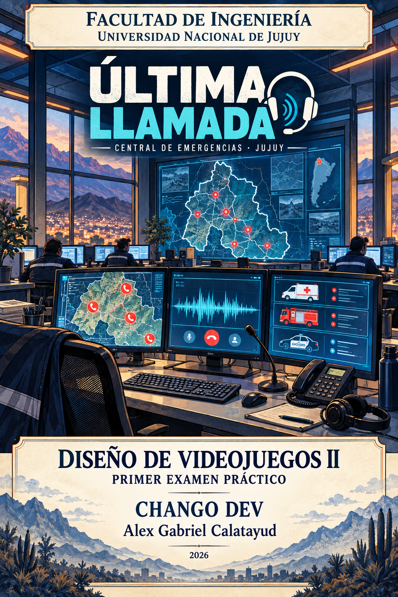
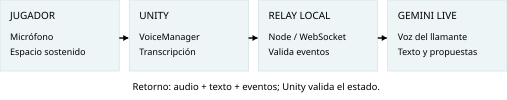
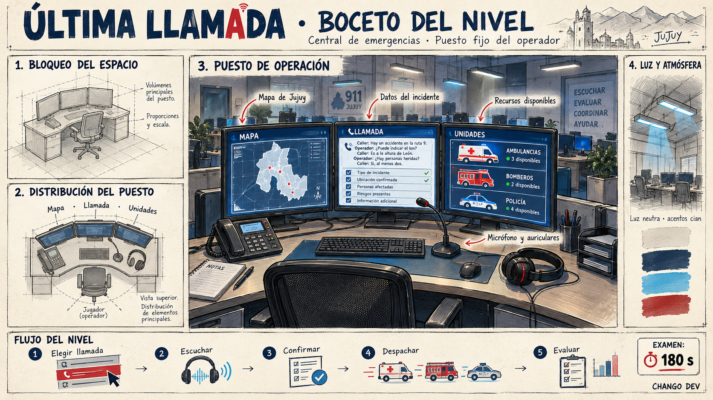
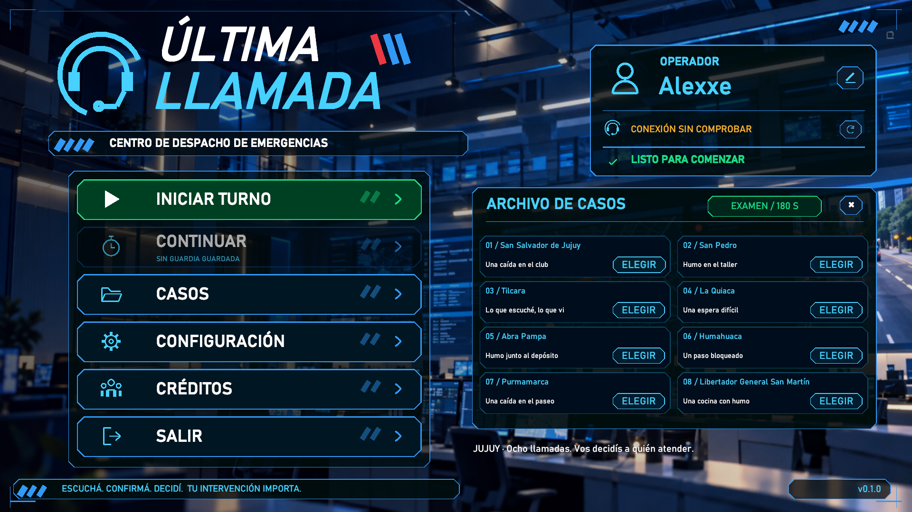
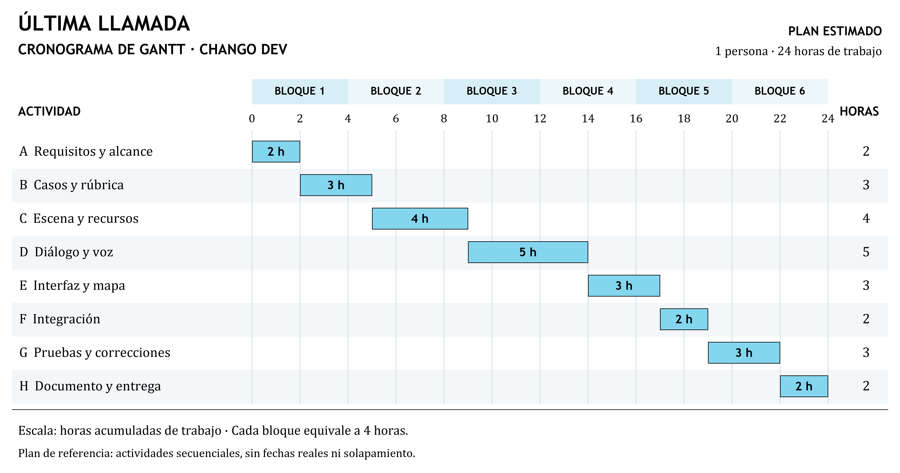

# Última Llamada
## Documento de diseño y nivel
**Institución:** Universidad Nacional de Jujuy
**Facultad:** Facultad de Ingeniería
**Carrera:** Tecnicatura Universitaria en Diseño Integral de Videojuegos
**Materia:** Diseño de Videojuegos II
**Instancia:** Primer Examen Práctico
**Grupo:** CHANGO DEV
**Estudiante:** Alex Gabriel Calatayud
**Comisión:** ____________________
**Docente:** ____________________
**Período:** 2026
**Revisión:** 05.10.2026 · Versión documental 1.5

Simulación de despacho de emergencias en Jujuy.
Escuchar. Confirmar. Decidir.
<!-- page -->
# Índice

{{INDICE}}

## 1. Presentación y GDD
Última Llamada es un **juego serio de comunicación y toma de decisiones** para una persona. Desde una central ficticia, el jugador elige una llamada, escucha, verifica información y decide qué recurso enviar. La guardia recorre ocho localidades de Jujuy; el nivel de examen concentra la experiencia en un caso de hasta tres minutos.

**Público previsto:** estudiantes y jóvenes o adultos interesados en comunicación. **Plataforma:** Windows. **Motor:** Unity 6000.6.0f1. El aprendizaje está en las acciones del juego: preguntar con claridad, no asumir hechos y justificar una decisión. La auditoría permite revisar el intento y volver a practicar. [2]

## 1.1 Concepto, experiencia e impacto
| Dimensión | Aplicación en el juego | Indicador propuesto |
|---|---|---|
| Social · eje principal | Escucha, respeto y verificación ante una persona nerviosa. | Datos confirmados y claridad entre dos intentos. |
| Económica | Asignación deliberada de recursos limitados. | Despachos correctos e innecesarios. |
| Ambiental | Reflexión sobre traslados y uso responsable de recursos. | Asignaciones evitables y consumo del modo local/Live. |

Son objetivos de diseño: todavía no se midieron mejoras educativas, ahorros ni emisiones. La simulación no equivale a capacitación profesional ni reproduce un protocolo oficial de emergencias. [2, diap. 5 y 11-14]
<!-- page -->
# 2. LDD: nivel y personajes
## 2.1 Descripción rápida · Una caída en el club
Lucía llama porque su hermano Martín se cayó mientras jugaban. El operador permanece en un puesto con tres monitores; conoce la escena del incidente a través de la conversación. Debe ubicar el hecho, comprender la situación, enviar una ambulancia y comunicar el cierre.

**Acceso:** menú → Casos → Examen / 180 s → Iniciar examen. Solo se habilita esta llamada. El reloj comienza al confirmar el inicio e incluye selección, conexión, diálogo y despacho; **el menú no lo pausa**. Se puede finalizar antes del límite. La lectura posterior de la auditoría queda fuera del tiempo jugable.

## 2.2 Personajes principales
| Personaje | Función narrativa y jugable |
|---|---|
| Operador · jugador | Escucha, pregunta, confirma y asigna recursos. Nombre de perfil editable. |
| Lucía · llamante | Joven de 19 años, nerviosa y cooperativa. Aporta información mediante diálogo. |
| Martín · afectado | Hermano de Lucía. Está consciente y responde; se lo describe, no se lo controla. |
| Supervisor · informe | Ofrece devolución escrita sobre decisiones y comunicación. |

## 2.3 Información del caso
**Ubicación:** Club Deportivo Norte, San Martín 240, San Salvador de Jujuy. **Incidente:** caída durante un juego. **Personas:** una. **Estado:** consciente y responde al hablarle. **Riesgos:** no se observan peligros adicionales. Son datos de un caso ficticio.

## 2.4 Duración y progresión
Los últimos 30 segundos activan una alerta ámbar y una señal sonora. Al vencer el plazo se detienen audio y conversación, se cancela un despacho sin confirmar y se evalúa una sola vez lo registrado. No se envía ayuda automáticamente; una llamada sin atender obtiene cero puntos.

Reintentar restablece datos, recursos, informe y reloj. El examen conserva su resultado durante la sesión y no sobrescribe la guardia guardada. Una conexión lenta también consume tiempo: debe comprobarse antes de iniciar.
<!-- page -->
# 3. Controles y tecnología
| Entrada | Acción |
|---|---|
| Mouse / clic | Elegir una señal, atender, seleccionar recurso y confirmar acciones. |
| F1 o 1 / F2 o 2 / F3 o 3 | Enfocar mapa / llamada / unidades. |
| F4 o 0 | Volver a la vista completa del escritorio. |
| M / rueda / arrastre | Abrir mapa de Jujuy / acercar / desplazar. Botón Centrar disponible. |
| Botón derecho del mouse | Mirada limitada desde el puesto; no hay desplazamiento del personaje. |
| Espacio sostenido · Live | Capturar voz; soltar para terminar el turno. Máximo 30 s por intervención. |
| Campo de texto + Enter | Enviar una intervención escrita para ensayo y alternativa de acceso. |
| Esc / Menú | Abrir el menú cuando el estado lo permite. No detiene el examen. |
| 1 o F1 / 2 o F2 · resultados | Alternar puntaje / informe completo. |

## Tecnología elegida: Voice Command
El jugador habla con el llamante y puede cambiar de monitor con cuatro frases completas: **«central mostrar mapa»**, **«central mostrar llamada»**, **«central mostrar unidades»** y **«central mostrar escritorio»**. El juego normaliza mayúsculas, acentos y puntuación, y las interpreta al completar la transcripción del turno.

Estos comandos no aportan puntos ni cuentan como preguntas del caso. La navegación también admite texto, útil para comprobarla de forma local. El ensayo sin conexión utiliza respuestas escritas por palabras clave; no ofrece reconocimiento de voz offline.

> **Estado de verificación:** el parser y la ruta de transcripción se probaron con entradas sintéticas. La captura con micrófono físico y el reconocimiento real de Gemini Live siguen pendientes de aceptación manual.
<!-- page -->
# 4. Reglas y mecánicas
## Objetivo, retos y reglas
**Oposición:** no hay enemigos ni combate. La dificultad surge de la información incompleta, el tiempo y la disponibilidad de recursos.

**Objetivo:** completar una atención con información suficiente, recurso adecuado y cierre comunicado dentro de 180 segundos. Los retos son distinguir lo observado de lo supuesto, contener a una persona nerviosa, evitar preguntas repetidas y coordinar recursos disponibles.

| Regla | Consecuencia jugable |
|---|---|
| Seleccionar y atender son acciones distintas. | Se puede inspeccionar una señal antes de responder. |
| La llamada activa se conserva. | Una nueva señal no reemplaza la conversación actual. |
| El despacho requiere ubicación y unidad disponible. | La selección abre una confirmación antes de asignar. |
| Se asigna una unidad por caso. | Elegir un tipo incorrecto penaliza la decisión táctica. |
| Finalizar sin despacho está permitido. | El resultado refleja la atención incompleta. |
| La llegada de una unidad no cierra la llamada. | El operador debe comunicar el envío y finalizar. |

## Mecánicas y respuesta del sistema
**Diálogo y hechos.** Las respuestas alimentan cinco campos: ubicación, incidente, personas, estado y riesgos. Preguntar por un solo tema y confirmar permite reducir ambigüedades. El sistema conserva transcripción y evidencias para explicar la evaluación.

**Despacho.** Ambulancias AMB-04 / AMB-05, bomberos BOM-02 y patrullas PAT-03 / PAT-07 tienen estados disponible → en camino → en escena → disponible. Sus ETA nominales son 3, 5, 4, 8 y 6 minutos, respectivamente. La simulación comprime esos tiempos; no calcula rutas reales.

**Retroalimentación.** El HUD muestra hechos obtenidos, disponibilidad y tiempo. Al terminar, desglosa la nota por áreas y permite consultar razones, repetir el caso o volver al menú.

## Ejemplo de recorrido esperado
1. Elegir la señal de San Salvador de Jujuy y atender a Lucía.
2. Preguntar dónde ocurrió y qué pasó; verificar personas, estado y riesgos.
3. Resumir los datos y confirmar que se comprendieron correctamente.
4. Elegir una ambulancia disponible y confirmar el despacho.
5. Comunicar que la ayuda está en camino, cerrar y revisar el informe.
<!-- page -->
# 5. Boceto del nivel
## Cámara, distribución y objetos
El jugador ocupa un puesto fijo con vista en primera persona: mapa a la izquierda, llamada en el centro y unidades a la derecha. La cámara enfoca cada monitor con transiciones; no hay locomoción. Teléfono, teclado, micrófono y auriculares sitúan la acción en una central de emergencias.

**Del boceto al prototipo:** se conserva mapa → llamada → unidades. El catálogo implementado define los cinco recursos y los datos válidos del caso.
<!-- page -->
# 6. Escenarios de Jujuy
La guardia ampliada permite elegir a quién responder. Las señales aparecen progresivamente en un mapa provincial local, con localidades de Valles, Yungas, Quebrada y Puna. El nivel de examen utiliza únicamente el caso 01.

| Caso / localidad | Situación ficticia | Recurso |
|---|---|---|
| 01 · San Salvador de Jujuy | Caída en un club · Lucía | Ambulancia |
| 02 · San Pedro | Humo en un taller · Diego | Bomberos |
| 03 · Tilcara | Posible choque; distinguir relato y observación · Elena | Policía |
| 04 · La Quiaca | Descompensación en una espera · Rosa | Ambulancia |
| 05 · Abra Pampa | Fuego junto a un depósito · Tomás | Bomberos |
| 06 · Humahuaca | Acceso bloqueado por un vehículo · Javier | Policía |
| 07 · Purmamarca | Caída durante un paseo · Inés | Ambulancia |
| 08 · Libertador Gral. San Martín | Humo en una cocina · Nora | Bomberos |

**Estados:** rojo en espera, cian seleccionada o activa, verde atendida; nombres y etiquetas acompañan los colores. El mapa admite arrastre, zoom y centrado. Una lista muestra los tiempos de espera. Cartografía basada en GeoRef / IGN. [5]
<!-- page -->
# 7. Evaluación y progresión

| Área | Máximo | Qué se evalúa |
|---|---|---|
| Precisión | 40 | Ubicación 10; incidente, personas y estado 8 cada uno; riesgos 6. |
| Comunicación | 25 | Pertinencia, claridad, empatía, escucha y respeto; evidencia del diálogo. |
| Decisión táctica | 20 | Despachar el tipo de recurso correcto. |
| Eficiencia operativa | 10 | Con al menos 20 puntos de información: penaliza turnos extra desde el noveno y repeticiones. |
| Protocolo | 5 | Confirmar datos: 2. Comunicar el cierre con despacho: 3. |

## Contenido y justificación, no cantidad de texto
La revisión de IA recibe la conversación completa y solo puede modificar **Comunicación**: cinco criterios de 0 a 5 con explicación y citas del operador. Se validan rangos, criterios únicos y presencia de esas citas en el diálogo. Una respuesta inválida o ausente conserva la rúbrica local, identificada en pantalla.

El cálculo local considera aportes pertinentes, claridad, escucha, interrupciones y repeticiones. No premia caracteres ni velocidad al hablar. El informe separa aciertos y mejoras; un caso vacío vale cero. Las demás áreas dependen de hechos y acciones del juego.

**Resultado:** desde 90, excelente; desde 75, resuelto; desde 60, parcial; menos de 60, revisar. La falta de despacho o el recurso incorrecto tienen un estado específico. La nota evalúa la simulación, no una competencia profesional.
<!-- page -->
# 8. Arte, interfaz y sonido

## Jerarquía visual de juego 2D
El puesto tridimensional se combina con un HUD de paneles angulares, fondo azul oscuro, títulos claros y acentos cian. Verde identifica confirmación; rojo, espera o finalización; ámbar, atención. El menú organiza Iniciar turno, Continuar, Casos, Configuración, Créditos y Salir. Continuar informa si todavía no existe una guardia guardada.

## Respuestas que hacen visible la acción
Los botones tienen estados de foco, hover, presión y deshabilitado. Las señales del mapa pulsan y la cámara se desplaza suavemente entre monitores. El puntaje asciende durante aproximadamente **1,65 s**, seguido por barras de áreas y efectos sonoros. Cambiar de pestaña no repite toda la animación si la nota no cambió.

Los efectos procedurales distinguen clic, nueva llamada, despacho y recompensa. Voz y efectos usan fuentes separadas. El usuario puede ajustar volumen y modo de conversación; no se presenta una banda sonora original como parte del alcance actual.

## Acceso y comprensión
La transcripción y el envío por texto ofrecen una alternativa a la voz. Las etiquetas acompañan iconos y colores; teclado y botones permiten acceder a vistas y resultados. El nombre del operador es editable. No se ha certificado accesibilidad ni implementado una preferencia de movimiento reducido.
<!-- page -->
# 9. Cronograma de desarrollo
El Gantt organiza las actividades de Última Llamada para **Alex Gabriel Calatayud, integrante de CHANGO DEV**. Se plantea una secuencia de trabajo para una persona: una actividad comienza cuando termina la anterior.

## Cómo leer el cronograma
Cada fila representa una actividad y cada barra indica su inicio, duración y final. La escala superior expresa horas acumuladas de trabajo. Los seis bloques agrupan cuatro horas cada uno; no equivalen a fechas del calendario ni a jornadas completas.

## Resultados previstos por etapa
| Etapa | Resultado a obtener |
|---|---|
| A-B · Definición | Alcance del nivel, ocho casos ficticios y criterios de evaluación. |
| C-D · Construcción | Puesto de tres monitores, recursos, diálogo y entrada de voz. |
| E-F · Experiencia e integración | Mapa de Jujuy, HUD, menú y conexión entre los sistemas. |
| G-H · Verificación y entrega | Pruebas del prototipo, correcciones, documentación y build. |

**Alcance de la estimación:** 24 horas de trabajo efectivo. Es una planificación orientativa del ciclo de desarrollo, no un registro de horas ya realizadas. Los tiempos de aprendizaje, espera de servicios y disponibilidad personal pueden ampliar el calendario. Las pruebas efectivamente registradas se describen en la página siguiente.
<!-- page -->
# 10. Pruebas del prototipo

## Evidencia del prototipo · 04.10.2026
| Verificación | Resultado registrado |
|---|---|
| Examen y comandos / mapa de Jujuy | 30 / 42 comprobaciones aprobadas |
| HUD y evidencias / menú y continuidad | 17 / 40 comprobaciones aprobadas |
| Escena y referencias | 1263 comprobaciones estructurales aprobadas |
| Backend con datos sintéticos | 14 pruebas aprobadas |
| Build Windows / compilación C# | Build correcta; 0 errores y 0 advertencias C# finales |

Ciclo: planificar, ejecutar, informar, corregir y volver a probar. [3] Se usaron entradas sintéticas y reloj controlado, sin micrófono físico. SearchDatabase emitió diagnósticos en algunos inicios, sin impedir la build. Evidencia: Artifacts/exam-delivery-validation.txt.

## Defecto corregido · EX-BUG-01
**EX-BUG-01 · Severidad alta · Jugabilidad.** En la guardia anterior, iniciar y mantener una llamada no imponía cierre a 180 s. Se esperaba un nivel de hasta tres minutos. CHANGO DEV incorporó Examen / 180 s y cierre de estados pendientes. Corregido y comprobado automáticamente. [3, p. 14]

## Aceptación todavía pendiente
- Verificar micrófono, cuatro comandos hablados, transcripción y audio en Gemini Live; captura detenida al soltar Espacio o perder foco.
- Medir el cierre con un reloj externo, incluso con menú o grabación activa, y probar la build en la PC de presentación.
- Ensayar con 3 a 5 participantes, dos intentos por persona: registrar decisiones, datos, tiempo, nota y dificultades. No se atribuye eficacia educativa sin ejecutar este estudio.

## Criterio de aceptación
Antes de presentar, comprobar que se puede iniciar el examen, atender el caso, registrar datos, confirmar una unidad y llegar al informe. La prueba oral debe verificar los cuatro comandos y el corte de captura; la prueba temporal debe confirmar el cierre de 180 segundos. Registrar cada resultado como aprobado, fallido o pendiente, con observaciones.
<!-- page -->
# 11. Entrega y referencias
## Material que acompaña al documento
**Proyecto:** escena UltimaLlamada.unity y catálogo Assets/Resources/Cases/cases.json. **Ejecutable:** Artifacts/SceneValidationBuild/UltimaLlamada.exe, junto con todos los archivos de esa carpeta. **Documento editable:** Docs/UltimaLlamada_Examen_Practico.md. **Evidencia:** reportes y capturas en Artifacts. README.md explica la puesta en marcha; Docs conserva las notas técnicas ampliadas.

**Equipo informado:** CHANGO DEV · Alex Gabriel Calatayud. Casos y direcciones son ficticios. La portada y el boceto son ilustraciones generadas con IA; las capturas restantes proceden del prototipo. El fondo del lobby y las referencias visuales fueron aportados durante el proyecto; los recursos importados conservan sus licencias de origen. Revisar esos permisos antes de una publicación comercial.

**Arquitectura:** Unity 6000.6.0f1 y C#. La escena guardada separa Environment, Operator, EmergencySystem, Units, UI, Audio y Systems. El modo local funciona con texto; Live utiliza Node.js y Gemini, con credenciales privadas fuera del paquete. Abrir la escena y Play, o la build completa; para Live, configurar y arrancar el backend según README.md.

**Alcance:** juego individual sin rutas reales ni reconocimiento de voz offline. El examen no guarda una partida independiente; la guardia conserva cola, unidades y transcripción, pero no audio. Live transmite audio y texto al servicio de Google. Comisión y docente: por completar.

## Referencias académicas
**[1]** UNJu, Facultad de Ingeniería. *Primer Examen Práctico, Diseño de Videojuegos II*. Período 2026, p. 1. Define seis apartados, una tecnología y nivel de hasta tres minutos. Fecha de entrega indicada: 02.10.2026.

**[2]** *Clase 04 - Juegos Serios*. Material suministrado, 23 diapositivas. Triple impacto: diap. 5; juego serio y gamificación: 11-13; clasificación y finalidades: 14-22.

**[3]** *Game Testing*. Material suministrado, 18 páginas. Categorías y severidad: pp. 2-9; ciclo de pruebas: p. 10; reporte de defecto: p. 14.

**[4]** *Proyect T.E.R.A. GDD*, 2026, 28 páginas. Referencia de organización para concepto, nivel breve, controles, interfaz, arte y sonido. Su historia, equipo y mecánicas no se atribuyen a este proyecto.

**[7]** *Vibe Coding - Examen Práctico DVJ II*, ejemplo suministrado, 8 páginas. Referencia de estructura GDD/LDD y cronograma; no se reutilizan sus personajes, integrantes ni resultados.

## Referencias técnicas

**[5]** GeoRef, Argentina.gob.ar. [Descarga de la base completa](https://www.argentina.gob.ar/georef/descarga-de-la-base-completa). Fuente geográfica utilizada para el mapa y localidades.

**[6]** Google AI for Developers. [Gemini Live API overview](https://ai.google.dev/gemini-api/docs/live-api). Referencia de transporte de voz y transcripciones. Consulta de ambas fuentes: 04.10.2026.

La documentación describe el estado comprobado del código y distingue pruebas automáticas de validación humana. La versión resumida mantiene los requisitos académicos en **12 páginas, incluida la portada**.
