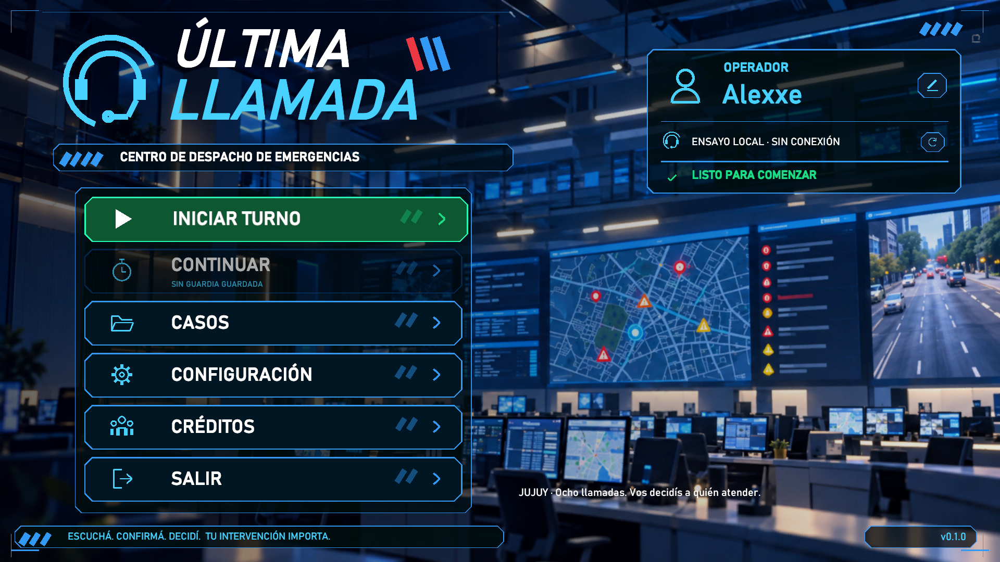
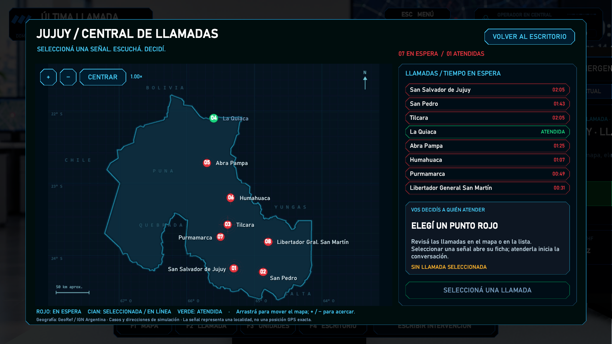
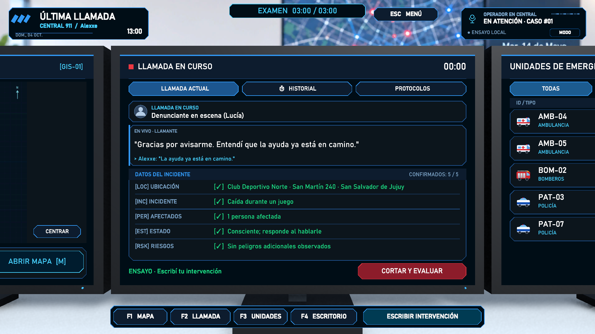
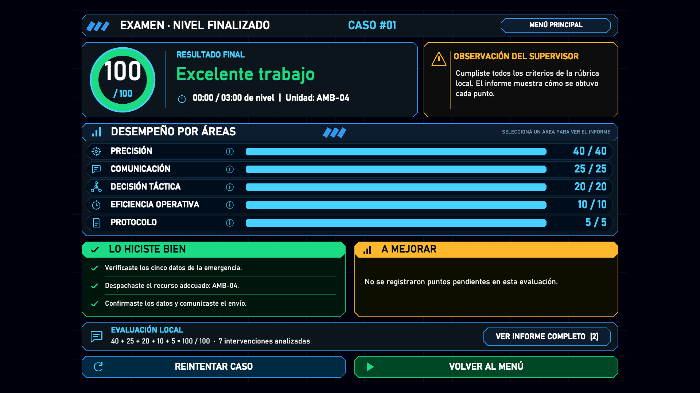

# Última Llamada

**Simulador 911 en Jujuy · CHANGO DEV · Alex Gabriel Calatayud**



Elegí a quién atender, escuchá al llamante y decidí qué unidad enviar. Un juego serio de comunicación con una central de tres monitores, un mapa de Jujuy y ocho situaciones ficticias.

**Unity 6000.6.0f1 · Windows · Un jugador · Ensayo local o Gemini Live**

## Capturas del juego

### Llamadas entrantes en Jujuy



### Atención y datos del incidente



### Evaluación del despacho



Las capturas muestran el prototipo. El resultado 100/100 y el reloj 00:00 corresponden a una prueba local controlada, no a una partida humana ni a una evaluación remota.

## Descargar y abrir el proyecto

```sh
git clone https://github.com/4lexxe/SIMULADOR_911_UNITY.git
```

En Unity Hub, agregá la carpeta clonada y abrila con **Unity 6000.6.0f1**. Esperá la importación de assets, abrí `Assets/Scenes/UltimaLlamada.unity` y presioná Play. El modo **Ensayo local** funciona sin API key ni backend. Para voz, instalá Node.js 22 o superior y seguí la configuración de Gemini Live de este README.

El repositorio incluye `Assets`, `Packages`, `ProjectSettings`, `Backend`, la documentación y capturas. Unity regenera `Library` al abrirlo. Las claves privadas, dependencias instaladas y builds locales no se versionan.

## Documentación del proyecto

- [Documento académico en PDF · 12 páginas](output/pdf/UltimaLlamada_Examen_Practico_CHANGO_DEV.pdf)
- [Fuente editable del documento](Docs/UltimaLlamada_Examen_Practico.md)
- [Portada ilustrada](Docs/Figuras/portada_ultima_llamada.png)
- [Boceto ilustrado del nivel](Docs/Figuras/boceto_nivel_ilustrado.png)
- [Cronograma de Gantt](Docs/Figuras/gantt_ultima_llamada.png)

La portada y el boceto son ilustraciones conceptuales generadas con IA; las capturas de la galería proceden del juego. El Gantt es una planificación estimada, no un registro de horas trabajadas.

Serious game para PC en Unity 6000.6.0f1. Un puesto de coordinación, ocho llamadas ficticias en distintas localidades de Jujuy y una evaluación sobre escucha, preguntas, verificación de información y decisiones.

## Ejecutar

1. Abrí `Assets/Scenes/UltimaLlamada.unity` y presioná **Play**. Si todavía no existe, usá **Tools → Última Llamada → Abrir escena editable**.
2. El menú principal abre **Iniciar turno**, **Continuar**, **Casos**, **Configuración**, **Créditos** y **Salir**. En Configuración se elige **Ensayo · texto** o **Voz · Gemini Live**, el nombre del operador y el volumen.
3. **Iniciar turno → elegir punto rojo en Jujuy → Atender llamada → conversar → asignar y confirmar una unidad → comunicar el cierre → Finalizar → evaluación → Elegir siguiente llamada**.

El lobby usa `Assets/Resources/UI/LobbyBackground.png`, el fondo proporcionado para el menú. Sus botones, iconos y marcos son UI nativa de Unity. **Continuar** conserva la llamada al volver desde el menú durante una sesión; después de cerrar el juego recupera los casos completos y restaura la selección pendiente y los tiempos de la bandeja. Una llamada sin finalizar se reinicia. El estado de voz se consulta al abrir el menú y puede volver a comprobarse con el botón de actualización.

El ensayo local permite completar los ocho casos sin cuentas ni conexión. Es un intérprete limitado de preguntas escritas, no reconocimiento de voz ni una IA. El modo Live permite conversación libre por voz y entrada de texto accesible; las respuestas provienen de Gemini.

## Nivel del Primer Examen Práctico

**Casos → Examen / 180 s → Iniciar examen** abre «Una caída en el club» en San Salvador de Jujuy. El límite incluye selección, conexión y conversación; no se pausa al abrir el menú. Al vencer detiene la voz, cancela despachos sin confirmar y evalúa lo registrado. Reintentar reinicia los 180 segundos. El examen no sobrescribe `ultimo-turno.json`; la guardia normal de ocho casos permanece disponible.

La documentación académica de **CHANGO DEV / Alex Gabriel Calatayud** está en [Docs/UltimaLlamada_Examen_Practico.md](Docs/UltimaLlamada_Examen_Practico.md), con PDF en `output/pdf/`. Comisión y docente quedan para completar.

En Live, mantener Espacio y decir **«central mostrar mapa»**, **«central mostrar llamada»**, **«central mostrar unidades»** o **«central mostrar escritorio»** cambia la cámara cuando llega el final del turno transcrito. También se admiten como texto de ensayo. Son comandos de navegación, no de despacho. Los turnos reconocidos se excluyen de la eficiencia y de las etiquetas locales. La entrada oral sigue dependiendo de Gemini y del micrófono real.

`EmergencyDispatch.Editor.ExamValidation.Run` verifica el nivel cronometrado, estados al vencer, reintento y comandos por transcripción sintética. La prueba física de reconocimiento de voz y la sesión con participantes se documentan como pendientes.

## Controles

| Control | Acción |
|---|---|
| Mantener Espacio | Hablar por micrófono en modo Live |
| Soltar Espacio | Enviar fin de intervención y escuchar |
| 0 / F4 | Vista del escritorio |
| Escape / Menú | Abrir o cerrar el menú cuando no se está hablando ni recibiendo audio |
| 1, 2, 3 | Acercarse al mapa, llamada o recursos |
| Botón derecho del mouse | Mirada limitada desde el puesto |
| Texto / accesibilidad | Mostrar entrada escrita en modo Live |
| Enter / Enviar | Enviar intervención escrita |
| M / Abrir mapa | Tablero provincial de llamadas |
| Punto rojo / fila de bandeja | Seleccionar la llamada; luego pulsar Atender |
| Arrastrar / rueda / + / − / Centrar | Mover y acercar el mapa provincial |

Espacio no cambia la cámara ni activa botones. El micrófono se abre solo mientras se mantiene la tecla, se cierra al perder foco y tiene un límite de 30 segundos por intervención.

## Voz con Gemini Live

Desde PowerShell:

```powershell
cd SIMULADOR_911_UNITY/Backend
npm.cmd ci
if (!(Test-Path .env)) { Copy-Item .env.example .env }
# Editar .env y completar GEMINI_API_KEY.
npm.cmd start
```

El relay escucha únicamente en `127.0.0.1:8787`. `GET /health` informa si está configurado, sin revelar la clave. Unity usa `ws://127.0.0.1:8787`; se puede cambiar en **Tools → Última Llamada → Configurar conexión de voz**. Una dirección remota debe usar `wss://`; el backend incluido está pensado para uso local, no para exponerlo públicamente.

La API key queda en `Backend/.env`, excluido de Git. Las claves heredadas en PlayerPrefs se eliminan al iniciar. El código anterior contenía una credencial incrustada: revocala o rotala en su proveedor antes de configurar una nueva.

`GEMINI_MODEL` es configurable en `.env`. El ejemplo contiene el valor usado durante el desarrollo; configurá un modelo Live disponible para tu cuenta. La conexión depende de las credenciales, el modelo y la cuota. Ante un error se muestra el estado y se ofrece **Continuar en ensayo**: nunca se sustituyen silenciosamente las respuestas Live por una simulación.

## Reglas del juego

Los casos se almacenan en [cases.json](Assets/Resources/Cases/cases.json). Unity y el backend leen ese mismo catálogo. El caso 3 distingue entre un choque supuesto y lo realmente observado.

| Categoría | Máximo | Cálculo |
|---|---:|---|
| Información | 40 | Ubicación 10, incidente 8, personas 8, estado 8, riesgos 6; los datos dudosos requieren verificación |
| Comunicación | 25 | Auditoría IA: pertinencia, claridad, contención, escucha y trato, de 0 a 5 cada uno, con citas del operador. En ensayo/fallo de IA: rúbrica local de relevancia, claridad y escucha, identificada en pantalla |
| Decisión | 20 | Recurso coincidente con la regla ficticia del caso |
| Eficiencia | 10 | Requiere al menos 20 puntos de información; baja por repeticiones e intervenciones por encima de 8 |
| Manejo | 5 | Confirmación 2; comunicación del cierre con recurso asignado 3 |

No se otorgan puntos por rapidez ni por escribir más. Una llamada vacía obtiene 0. Al finalizar una llamada Live, `/evaluate` revisa toda la transcripción y propone los cinco criterios de comunicación. Tanto el backend como Unity comprueban sus límites y que las citas pertenezcan al operador; las citas inventadas o del llamante invalidan la evaluación. Unity suma la nota, actualiza el grado y el feedback. La IA no modifica precisión, despacho, eficiencia ni protocolo. Mientras espera se indica «resultado provisional»; ante un fallo se conserva la evaluación local sin inventar un dictamen.

El HUD de auditoría incluye un medidor circular, cinco barras, aciertos, puntos pendientes y un informe desplazable con las reglas, citas y conversación completa. Las áreas y el botón «Ver informe completo» abren el desglose. Teclas 1/F1 y 2/F2 cambian entre puntaje e informe. Los totales de guardia suman los promedios de las cinco áreas. `GEMINI_EVALUATION_MODEL` permite configurar el modelo de auditoría; reiniciá el relay después de cambiar su código o configuración.

Solo puede asignarse una unidad por caso, después de obtener la ubicación. El despacho necesita confirmación. Llegar al lugar no interrumpe la llamada; las unidades vuelven a estar disponibles tras su atención. Finalizar sin despacho es posible con confirmación y se refleja en la evaluación.

El resultado se guarda como `ultimo-turno.json` en `Application.persistentDataPath`, incluyendo notas, evidencias y transcripción de texto. No se guardan grabaciones de audio. El audio y las transcripciones de Live pasan por Google durante la sesión. Las validaciones automáticas no sobrescriben el informe del jugador.

## Estructura

- `Assets/Scenes/UltimaLlamada.unity`: escena guardada con Environment, Operator, EmergencySystem, Units, UI, Audio y Systems.
- `DispatchView`: enlaza y actualiza paneles guardados; no construye la interfaz. DispatchButton expone cada acción en el Inspector.
- `GameManager` / `CallSession`: turno, autoridad de hechos y puntuación.
- `VoiceManager`: push-to-talk, PCM16 mono a 16 kHz y reproducción a 24 kHz.
- `GeminiEmergencyService`: WebSocket con el relay, cancelación y entrega al hilo principal.
- `Backend/server.mjs`: sesión Live, transcripciones, validación de herramientas y límites.
- `OfflineConversation`: ensayo escrito sin conexión.

La sala de fondo usa `fondo.png`, provisto en el proyecto, como telón. El puesto, monitores, teclado, teléfono y auriculares existen como objetos 3D y prefabs antes de Play; se reutiliza el modelo de micrófono importado. Los modelos y la escena SampleScene originales se conservan. Webcam/head tracking queda fuera de este MVP.

La auditoría de la migración y las instrucciones de edición están en [Docs/SceneMigration.md](Docs/SceneMigration.md). El inventario exacto de cada objeto, componente, prefab y referencia está en [Docs/SceneHierarchy.md](Docs/SceneHierarchy.md). El Inspector de UI permite alternar Escritorio, Menú y Resultados sin Play. Los constructores anteriores fueron retirados de Assets.

## Verificación

`cd Backend; npm.cmd test` ejecuta pruebas del protocolo y del relay con WebSockets reales y un servidor Gemini simulado, sin consumir cuota.

`EmergencyDispatch.Editor.DispatchValidation.Run` ejecuta comprobaciones de reglas, el turno completo en Play Mode y capturas. Usarlo en una copia del proyecto ubicada en `Artifacts/ValidationProject`, con Unity en batch y sin `-quit`; el método sale al terminar. Las evidencias se guardan en `Artifacts/`.

Para incluir la integración del cliente C# con el relay, ejecutar `node Backend/test/unity-fixture.mjs` y agregar `-testRelay` al comando de Unity. La fixture escucha en el puerto local 18787, usa audio sintético y no se conecta a Google.

`EmergencyDispatch.Editor.HudAuditValidation.Run`, en la misma copia aislada, verifica 17 condiciones del HUD, puntuación, citas, informe completo, reintento y guardia; genera seis capturas `hud-*.png`. `npm.cmd test` incluye 14 pruebas del backend. `node Backend/test/evaluation-smoke.mjs --live` es una prueba opcional con el modelo real y dos conversaciones ficticias; consume cuota y guarda los resultados en `Artifacts/evaluation-live-fixture.json`. Las deducciones de la auditoría se revisan contra la conversación completa antes de aplicarse, dentro del mismo límite de 12 segundos.

`EmergencyDispatch.Editor.LobbyValidation.Run` comprueba navegación, configuración, selección de casos, continuación, recuperación de guardia y compatibilidad con informes anteriores. Genera las capturas `lobby-*.png` en 1080p, 720p y formato 4:3; no modifica las preferencias ni las partidas del jugador.

`EmergencyDispatch.Editor.SceneArchitectureValidation.Run` verifica la escena guardada, los assets, los prefabs, la conservación de cambios del Inspector al entrar en Play y la reutilización de paneles. No reconstruye el mundo.

Las pruebas locales no certifican una conversación real con Gemini ni la captura de un micrófono físico. Para esa aceptación: iniciar backend con clave válida, seleccionar Live, contestar, mantener Espacio, comprobar audio/subtítulos/datos, finalizar y revisar el resultado.

Referencias oficiales consultadas: [WebSockets Live](https://ai.google.dev/gemini-api/docs/live-api/get-started-websocket), [contrato de mensajes](https://ai.google.dev/api/live), [herramientas de Live](https://ai.google.dev/gemini-api/docs/live-api/tools).

Simulación educativa ficticia centrada en comunicación. No reemplaza capacitación profesional ni ofrece instrucciones para emergencias reales.

## Mapa de Jujuy y llamadas entrantes

El turno abre una bandeja con tres señales simultáneas. Otras cinco llegan progresivamente (22, 40, 58, 76 y 94 segundos de simulación). El operador elige el orden; los nuevos avisos no reemplazan la llamada activa. El menú y la auditoría pausan las llegadas y la espera. El tiempo de espera no cambia por sí solo la nota.

Rojo identifica una llamada pendiente, cian la selección o llamada activa y verde un caso atendido. El mapa indica el centro aproximado de la localidad. La dirección se obtiene conversando antes de poder despachar. Las unidades usan tiempos de viaje comprimidos, configurables con `UnitFleetManager.travelTimeScale`; no alteran la duración registrada de la conversación.

[Detalles de geografía, arquitectura y guardado](Docs/JujuyIncomingCalls.md). La escena incluye un tablero, marcadores, filas y controles editables. El Inspector de `DispatchView` permite previsualizar **Mapa Jujuy** sin Play. `EmergencyDispatch.Editor.JujuyGameplayValidation.Run` valida el flujo completo sin conexiones externas y produce capturas `Artifacts/jujuy-*.png`.
